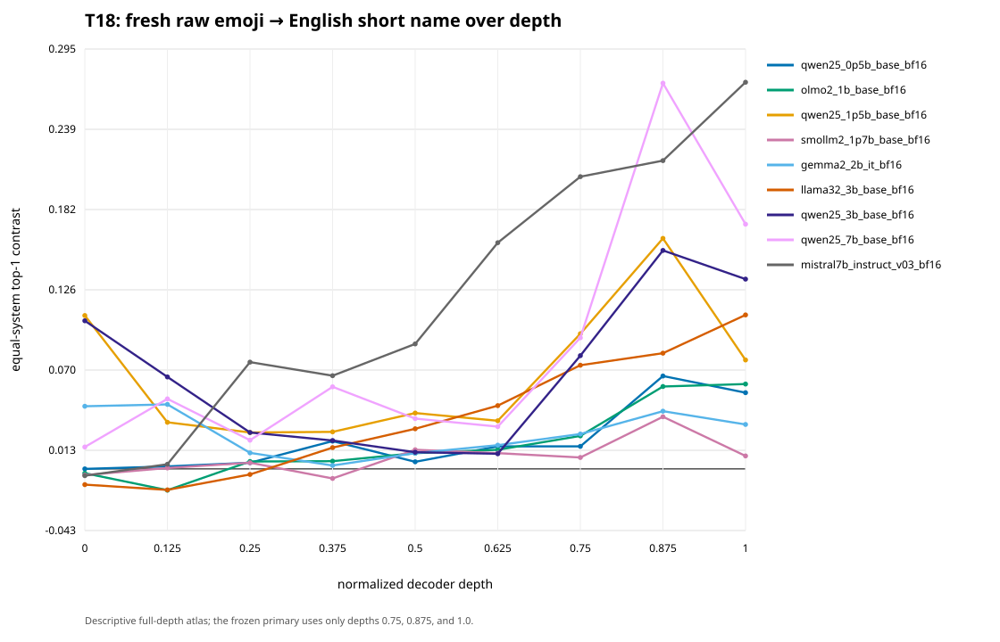

# T18 未提示の複合glyphに対する語彙対応確認 — 結果

[English](FRESH_COMPOSITE_GLYPH_LEXICAL_CONFIRMATION_V0_RESULTS.md) · [凍結済みprotocol](FRESH_COMPOSITE_GLYPH_LEXICAL_CONFIRMATION_V0.ja.md) · [一次判定](../validation/fresh_composite_glyph_lexical_confirmation_v0/results/cross_model_primary_result.json) · [独立検収](../validation/fresh_composite_glyph_lexical_confirmation_v0/independent_validation.json) · [論文ストーリー](PAPER_STORY_T18_FRESH_LEXICAL_V0.ja.md)

状態：**事前に固定した一次判定を、登録済みmodel cellの範囲で確認した**。

## 何が分かったか

研究内で一度も使っていなかった複数コードポイント絵文字でも、生のUnicode列は、
literalな`U+...`列より英語のEmoji短名を引くためのよいitem keyになった。一次判定に
使う4つのmodel/tokenizer cellは、全項目を使う評価とtoken数を完全一致させた評価の
両方で、統計条件と実用下限`0.02`を同じcell内で満たした。事前に決めた「4 cell中
3 cell以上」のpartial-conjunction検定は`p = 0.0001`で通過した。

登録した9 cell全体では8 cellが同じ統計＋実用ruleを通過した。SmolLM2だけは、
unrestricted差が`0.017940`で実用下限にわずかに届かなかった。集約すれば広く再現する。
一方で、効果が立ち上がる深さ、global CKA、正しく対応するitemの顔ぶれはmodelごとに
かなり違う。今回確認できたのは、**未提示の表層に対する、text-codepoint系列内の
item-specificな語彙結合**である。画像としてのglyph知覚、事前学習holdout、
人間のような意味理解、共通mechanismを示したわけではない。



## 対象と比較方法

対象はmodifier列64件、ZWJ列96件、regional indicator flag 32件の計192件。
Commit `85213ea9b493682c9198eadda5e20c5e5ab2a04d`のGit tree
`bc114c57fb25f9d08f12bea1bdf367002506bd67`にある通常blob 1,429件をすべて調べ、
採用したUTF-8表層が一度も出てこないことを確認した。T11の1,111 identityも全件除外した。
この選定はtokenizerを測る前、T18のmodel forwardを始める前に固定している。

各itemには、生の絵文字、英語Emoji短名、日本語CLDR短名、空白区切りのcodepoint列という
4表記を用意した。一次統計量は、3つのglyph系統と、後期24 contextを等しく重み付けした
次の差である。

```text
glyph → 英語短名のtop-1正解率
－
glyph → literal codepoint列のtop-1正解率
```

後期window（正規化深度`0.75`, `0.875`, `1.0`）、carrier 2種、suffix距離4点、
model roster、乱択seed、多重性rule、停止規則は、結果を見る前にpushした。ここでいう短名は、
Emoji 17のcomment nameと英語CLDR `tts`が一致するもの。単一scalarのUnicode Character
Nameを指すわけではない。

## 一次判定

各modelで、unrestrictedとtokenization-matchedを別々に19,999回入れ替え、2つのp値の
大きい方をmodel単位のIUT p値とした。差も両方`0.02`以上でなければ通過としない。

| Model cell | Unrestricted差［記述95%区間］ | Token一致差［区間］ | Matched n | Model IUT p | 判定 |
|---|---:|---:|---:|---:|---|
| Qwen2.5 0.5B base | 0.044922 [0.017361, 0.074942] | 0.045070 [0.011746, 0.081875] | 165 | 0.00010 | 通過 |
| OLMo 2 1B base | 0.046947 [0.024667, 0.071110] | 0.046161 [0.021801, 0.073413] | 149 | 0.00005 | **core通過** |
| Qwen2.5 1.5B base | 0.111256 [0.076098, 0.149233] | 0.119424 [0.078206, 0.162862] | 165 | 0.00005 | 通過 |
| SmolLM2 1.7B base | 0.017940 [-0.002027, 0.039207] | 0.025511 [0.002188, 0.049234] | 153 | 0.00005 | 実用下限未達 |
| Gemma 2 2B IT | 0.032118 [0.017506, 0.047671] | 0.030267 [0.014239, 0.046415] | 167 | 0.00005 | **core通過** |
| Llama 3.2 3B base | 0.087529 [0.053818, 0.124855] | 0.099401 [0.058343, 0.144095] | 147 | 0.00005 | **core通過** |
| Qwen2.5 3B base | 0.122251 [0.089263, 0.158058] | 0.133049 [0.097993, 0.170353] | 165 | 0.00005 | 通過 |
| Qwen2.5 7B base | 0.178530 [0.139972, 0.218316] | 0.192587 [0.151318, 0.235801] | 165 | 0.00005 | **core通過** |
| Mistral 7B Instruct v0.3 | 0.231409 [0.186632, 0.278865] | 0.251458 [0.198051, 0.306757] | 144 | 0.00005 | 通過 |

CoreはLlama、Qwen 7B、OLMo、Gemmaの4 cell。統計条件と実用条件を別々のmodelで
満たしたのではなく、4 cellすべてが両方を同時に通過した。Core IUT p値の3番目は
`0.00005`で、登録済みの係数2を掛けたpartial-conjunction p値は`0.0001`となる。
残る5 cellで一次結果を救済してはいない。

表の区間はitem bootstrapによる記述値である。一次判定は区間が0をまたぐかどうかではなく、
事前固定した同期randomizationで行った。

## Token数を揃えても残った

Tokenization-matched評価では、glyph系統と`(glyph, 英語短名, codepoint literal)`の
token数が完全に同じで、2件以上ある層だけを残した。Coverageは192件中144〜167件。
どのcellでもmodifier 51件、ZWJ 66件、flag 23件以上が残り、事前下限を超えている。

4つのcore cellは、matched差もすべて`0.02`を上回った。したがって、今回登録した
一次効果の全体を「表記間のtoken数が違うから」と説明することはできない。ただし、
token identity、merge履歴、byte経路、系列構造は揃っていない。Tokenizationから独立した
現象だとは結論しない。

## 日本語短名でも見える

日本語は二次解析であり、一次判定を救済する権限を持たない。日本語専用のtoken数一致層で
集計すると、後期windowの「日本語短名－codepoint」差は9 / 9 modelで正だった。
範囲は`0.017998`〜`0.267982`。全項目を使った差も9 / 9で正で、`0.007957`〜`0.214048`
だった。

英語table名だけを直接引いている、という説明だけでは足りなくなった一方、これを
言語非依存の意味理解とは読めない。英語名と日本語名自体が関係し、学習dataも不明で、
日本語について事前登録した推論familyは置いていない。ここで言えるのは、多言語の語彙対応が
二次的に観測されたことまでである。

## 集約は共通、実装はmodel固有

一次windowの3深度では、英語差の点推定が9 modelすべてで正だった。しかし全深度を見ると、
共通の相転移はない。Peakは`0.125`が1 model、`0.875`が5 model、returned finalが3 model。
序盤から正のmodelもあれば、後半に入ってから立ち上がるmodelもある。

後期windowのpaired-minus-off-diagonal marginは、unrestrictedでもmatchedでも9 / 9 modelで
英語短名を支持した。一方、centered linear CKAが同じ方向だったのはunrestrictedで5 / 9、
matchedでは3 / 9にすぎない。絵文字が自分の短名を引くkeyになっていても、絵文字行列全体が
短名行列へglobalに近づくとは限らない。

Item単位の共有度も低い。4 coreすべてで差が正だったのは192件中8件だけ。Core等重み平均が
正だったitemは143件だが、model pairごとのitem-effect Pearson相関は`0.0245`〜`0.2035`だった。
9 modelすべてで正だったitemは2件、9 model平均が正だったitemは164件である。

> 集約としては再現するが、語彙結合の中身はmodelごとにかなり私有されている。

Qwen 4点のmatched差は、checkpoint size順に`0.0451`, `0.1194`, `0.1330`, `0.1926`と
並んだ。しかし、data、architecture詳細、checkpoint identity、parameter数は交絡しており、
深度trajectoryも同じではない。Scale lawとは呼ばない。

## 実行と独立検収

| 監査項目 | 結果 |
|---|---:|
| Exact model/tokenizer role | 9 / 9 |
| 1 roleあたりのitem | 192 |
| 完了shard | 54 / 54 |
| Model forward | 13,824 |
| FP32 readout vector | 497,664 |
| Generation / intervention | 0 / 0 |
| 完了receiptの取得時間合計 | 124.565秒 |
| 最大CUDA allocation | 15,351,009,792 bytes |
| 炉上のraw run | 4,788,850,288 bytes、289 files |

Mistralの最初の試行では、shard 0へ入る前に別利用者のGPU processを検出してyieldした。
この時点のMistral科学forwardは0回。その後、同じfreezeのままshard 0から再開し、6 shardを
完走した。途中のyield receiptも消さずに残している。

独立validatorは一次analyzerをimportしていない。Freezeした1,429 blobの露出境界を再走査し、
selection、freeze、54 shard、summary hashを検証したうえで、18本のrandomization testを
別実装で再計算した。Core 4 / 4の同時通過とpartial-conjunction `p = 0.0001`は完全一致した。
Primary analysis receiptのSHA-256は
`799cb3cc2b27c17b3b2d861a8f92d9e629963fd5b2ab085d8bc5a7282772b10c`、
独立receiptは`a81228a4a187c692ff41fff83da239a2be4de8f6de05335f7be55b4d5eb8f4ad`である。

## 今回の貢献と、言ってはいけないこと

T17の弱点は、対象292件がT9/T10ですでに開かれていたことだった。T18では、tokenizerや
activationを見る前に、研究repoに対する完全一致表層holdoutを作り、そこで同じ語彙対応を
確認した。さらに、4 coreすべてで登録済みtoken数対照を通過した。ここが今回の新しい土台になる。

一方、次の主張は認めない。

- 事前学習、意味概念、構成要素、family、国、短名そのもののholdout
- 描画画像としてのglyph認識
- 人間のような絵文字の意味理解
- Tokenizerの因果効果、tokenizer非依存性
- 共通の相転移、回路、mediator、行動効果
- Instruction tuning、parameter scale、architecture一般性、model母集団一般性
- 9つの独立replication

9 cellは同じitemを共有し、学習data、tokenizer系譜、architecture lineageも重なり得る。
登録した9つの条件であり、model母集団から独立に抽出した9標本ではない。

## 次のgate

この結果から自然につながる分岐は三つある。いずれも別freezeを必要とする。

1. **語彙の幅**：正式短名、alias、paraphrase、事前選定した別言語labelを分ける。
2. **絵文字らしさの特異性**：名前を持つ非emoji Unicode記号と、token・label構造を揃えて比較する。
3. **因果局在**：4 coreで共有された8 itemとmodel-private itemを対比し、新しい未使用bank上で、
   後期`attn_out` / `mlp_out`の除去・追加・復元を事前固定する。

今回うまくいったitem、layer、componentを、そのまま確認的な因果主張へ昇格させない。

## Evidence

- [一次analysis receipt](../validation/fresh_composite_glyph_lexical_confirmation_v0/results/analysis_receipt.json)
- [9 modelのcell結果](../validation/fresh_composite_glyph_lexical_confirmation_v0/results/model_cell_results.json)
- [全深度profile](../validation/fresh_composite_glyph_lexical_confirmation_v0/results/depth_profiles.json)
- [結果後の二次解析](../validation/fresh_composite_glyph_lexical_confirmation_v0/results/secondary/secondary_analysis.json)
- [深度CSV](../validation/fresh_composite_glyph_lexical_confirmation_v0/results/secondary/depth_curves.csv) / [SVG](../validation/fresh_composite_glyph_lexical_confirmation_v0/results/secondary/depth_curves.svg)
- [独立検収](../validation/fresh_composite_glyph_lexical_confirmation_v0/independent_validation.json)
- [GPU競合によるyield receipt](../validation/fresh_composite_glyph_lexical_confirmation_v0/runtime_yield_receipt.json)
- Freeze manifest SHA-256：
  `4bd83f058d1226b9e3332b88ffa27db04368fcaffe34c6559228b934bb4f3eb1`
- Freeze commit：`c1c1f006edb6264d4042a53ad0e333e01ebc74ab`

約4.79 GBのraw activationは炉のscratchに残し、Gitへはコピーしていない。
