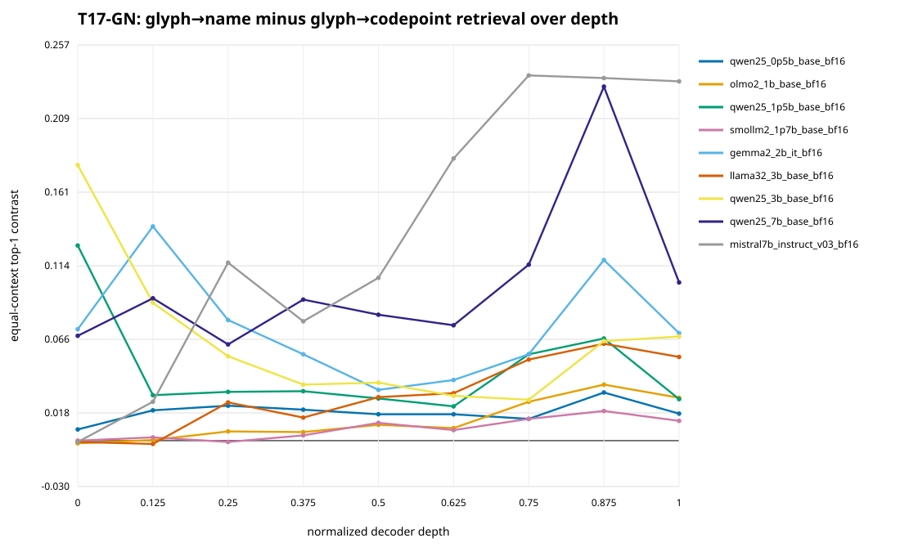

# T17-GN glyph–name depth-trajectory results

[日本語](GLYPH_NAME_DEPTH_TRAJECTORY_V0_RESULTS.ja.md) · [Frozen protocol](GLYPH_NAME_DEPTH_TRAJECTORY_V0.md) · [Compact analysis](../validation/glyph_name_depth_trajectory_v0/results/analysis.json) · [Independent validation](../validation/glyph_name_depth_trajectory_v0/independent_validation.json) · [Closeout](../validation/glyph_name_depth_trajectory_v0/closeout.json)

Status: **complete exploratory atlas on the prior-exposed T9/T10 population**.

## Result in one paragraph

The raw emoji surface became a better item-level key for its official Unicode
name than for its literal `U+...` codepoint string across the fixed nine-model
roster, but not through one universal late-layer transition. The equal-context
forward top-1 contrast was positive in all nine models from normalized depth
`0.375` through the returned final state. All nine 20,000-replicate item
bootstrap lower bounds were positive at depths `0.50`, `0.75`, `0.875`, and
`1.0`; exact token-count-matched point estimates were positive in all nine
models from `0.25` onward. Yet peak depth varied sharply: two models peaked at
the first block, one at `0.125`, one at `0.75`, and five at `0.875`. At the
final state, the paired-minus-off-diagonal margin favored name over codepoint
in 9/9 models, whereas centered linear CKA did so in only 4/9. The bounded
reading is therefore a broadly convergent, item-specific lexical retrieval
relation with model-specific onset and peak—not a shared phase transition, a
globally aligned semantic manifold, or rendered-glyph perception.

## What was compared

Each of the 292 items had three fixed textual views:

1. the raw Unicode emoji surface;
2. its official Unicode name;
3. the literal `U+...` codepoint string.

“Glyph” here means the raw Unicode string passed through each model's text
tokenizer. No rasterized font image was shown to a vision model. The headline
at each model and depth is the mean, over two carriers and four distances, of
the difference between forward top-1 item retrieval for emoji-to-name and
emoji-to-codepoint. A positive value says only that the correct official name
is retrieved more often than the correct codepoint literal under this fixed
hidden-state geometry.

The population had already been opened in T9 and T10. T17-GN was frozen before
its depth outcomes were acquired, but it is not an independent confirmation.

## Completed acquisition

| Audit field | Result |
|---|---:|
| Exact model/tokenizer roles | 9 / 9 |
| Items per role | 292 |
| Views | 3 |
| Contexts | 2 carriers × 4 distances |
| Normalized depths | 9 (`0.0` through `1.0`) |
| Completed shards | 90 |
| Model forwards | 15,768 |
| FP32 readout vectors | 567,648 |
| Generation / intervention calls | 0 / 0 |
| Acquisition elapsed time | 136.388 s |
| Maximum recorded peak CUDA allocation | 15,319,300,608 bytes |

The final fraction is the API-returned final hidden state and may include
model-final normalization. Intermediate fractions are hidden states after the
resolved decoder block. They are not silently treated as the same endpoint.

## Cross-model trajectory

Intervals in the model-level analysis resample items 20,000 times while
keeping all eight contexts for an item together. The table below is a
cross-model descriptive section, not a second inferential family.

| Normalized depth | Median contrast | Range across models | Positive point estimates | Positive bootstrap lower bounds | Positive token-count-matched estimates |
|---:|---:|---:|---:|---:|---:|
| 0.000 | 0.007277 | -0.001712 to 0.178938 | 5 / 9 | 5 / 9 | 6 / 9 |
| 0.125 | 0.025257 | -0.002140 to 0.139127 | 8 / 9 | 6 / 9 | 8 / 9 |
| 0.250 | 0.031678 | -0.000856 to 0.115582 | 8 / 9 | 8 / 9 | 9 / 9 |
| 0.375 | 0.032106 | 0.003425 to 0.091610 | 9 / 9 | 8 / 9 | 9 / 9 |
| 0.500 | 0.028253 | 0.010274 to 0.105736 | 9 / 9 | 9 / 9 | 9 / 9 |
| 0.625 | 0.029110 | 0.006849 to 0.183219 | 9 / 9 | 8 / 9 | 9 / 9 |
| 0.750 | 0.052654 | 0.014127 to 0.237158 | 9 / 9 | 9 / 9 | 9 / 9 |
| 0.875 | 0.064640 | 0.019264 to 0.235445 | 9 / 9 | 9 / 9 | 9 / 9 |
| 1.000 | 0.054366 | 0.012842 to 0.233305 | 9 / 9 | 9 / 9 | 9 / 9 |

The common result is not monotonic growth. It is a positive mid-to-late
cross-section reached by heterogeneous paths. The small dip in the
all-nine-interval count at `0.625` also prevents describing the curve as one
clean, irreversible threshold.

## Model-specific onset and peak

“Sustained CI depth” is the earliest sampled depth from which the model's
bootstrap interval remains above zero at every later sampled point. “Final
minimum” is the least of the eight context-specific top-1 contrasts at the
returned final state.

| Model | Matched n | Initial | Sustained CI depth | Peak depth / value | Final [95% interval] | Final minimum | Matched final |
|---|---:|---:|---:|---:|---:|---:|---:|
| Qwen2.5 0.5B base | 284 | 0.007277 | 0.000 | 0.875 / 0.031250 | 0.017551 [0.008134, 0.027825] | 0.006849 | 0.017606 |
| OLMo 2 1B base | 281 | -0.001712 | 0.250 | 0.875 / 0.036387 | 0.027825 [0.015839, 0.041524] | 0.013699 | 0.030249 |
| Qwen2.5 1.5B base | 284 | 0.126712 | 0.000 | 0.000 / 0.126712 | 0.026969 [0.017123, 0.037671] | 0.013699 | 0.024648 |
| SmolLM2 1.7B base | 287 | 0.000000 | 0.750 | 0.875 / 0.019264 | 0.012842 [0.003853, 0.022688] | 0.006849 | 0.013066 |
| Gemma 2 2B IT | 284 | 0.072346 | 0.000 | 0.125 / 0.139127 | 0.069777 [0.055223, 0.085188] | 0.017123 | 0.073504 |
| Llama 3.2 3B base | 281 | -0.000856 | 0.250 | 0.875 / 0.062928 | 0.054366 [0.034675, 0.075342] | 0.027397 | 0.057829 |
| Qwen2.5 3B base | 284 | 0.178938 | 0.000 | 0.000 / 0.178938 | 0.067637 [0.053082, 0.083476] | 0.017123 | 0.070423 |
| Qwen2.5 7B base | 284 | 0.068065 | 0.000 | 0.875 / 0.229880 | 0.102740 [0.080908, 0.125428] | 0.023973 | 0.106514 |
| Mistral 7B Instruct v0.3 | 285 | -0.000856 | 0.125 | 0.750 / 0.237158 | 0.233305 [0.200332, 0.267551] | 0.202055 | 0.237719 |

The Qwen final values happen to increase across the four checkpoint sizes in
this roster. Their paths do not: Qwen 1.5B and 3B peak at the first sampled
block, whereas 0.5B and 7B peak at `0.875`. Size, architecture details,
training data, and checkpoint identity are confounded, so this is not a scale
law.

## Item retrieval and manifold alignment separate

At the returned final state, the name-minus-codepoint
paired-minus-off-diagonal cosine margin was positive in all nine models. The
same contrast in centered linear CKA was positive only for OLMo, Gemma, Llama,
and Mistral. The remaining five models had a negative CKA contrast even though
their item retrieval and paired margin favored names.

This dissociation is important. The raw emoji can become a better key for its
own lexical label without making the complete emoji matrix globally more
similar to the complete name matrix than to the codepoint matrix. The study
therefore supports item-specific correspondence more strongly than wholesale
manifold convergence.

## Exact replay of the T10 boundary

An independent compact validator recomputed structural checks from the T17
analysis, CSV, and SVG. It also compared every returned-final unrestricted and
token-count-matched carrier-by-distance contrast against T10's published model
cell results. All `9 × 8` unrestricted cells and all `9 × 8` matched cells were
exact replays. This connects T17's trajectories to the prior final-state result
without changing T10's registered negative practical verdict.

The validator passed with:

- 81 CSV rows and 81 plotted points over nine model curves;
- 15,768 forwards and 567,648 readouts;
- all six claim-authorization flags false;
- T10 source result SHA-256
  `aed7c4abf53b349afe762e359e75193e7b129e9f90ff84c813a5e76ca47fbcfb`.

## Preserved runtime failures

Two runtime probes failed before any candidate model forward or weight load:
the furnace system Python lacked `glyphprobe`, and the same interpreter with
`PYTHONPATH=src` lacked `pydantic`. The scientific design was unchanged. The
first candidate forward used an existing project runtime with Torch
`2.13.0+cu132`, Transformers `5.15.0`, NumPy `2.5.2`, PyYAML `6.0.3`, and
GlyphProbe `0.1.0`. The failures remain in the validation receipt rather than
being erased from the run history.

## Claim boundary and next gate

T17-GN supports an exploratory depth atlas for raw emoji surface, official
Unicode name, and codepoint-literal geometry in nine exact model/tokenizer
cells. It does **not** establish visual glyph perception, human-like emoji
meaning, understanding, tokenizer independence, causality, a circuit,
instruction-tuning effects, parameter scaling, independent replication, or
generality to a model or emoji population.

The clean next gate is a new, unexposed item population fixed before outcome
opening. It should separate the official Unicode name from aliases,
paraphrases, and multilingual names while retaining the codepoint literal and
tokenization-matched strata. Only a result that survives that gate should
select a common late window for causal name-information removal, addition, and
restoration.

## Evidence

- [Compact analysis](../validation/glyph_name_depth_trajectory_v0/results/analysis.json), SHA-256 `ed615103d85608893caf207c856a01922a4e744c6f9713f0293aa223bf8139e4`
- [Depth-curve CSV](../validation/glyph_name_depth_trajectory_v0/results/depth_curves.csv), SHA-256 `806780db8d74e06f038e32820c355d8ef54733530aab59ed2777137dabcd2098`
- [Depth-curve figure](../validation/glyph_name_depth_trajectory_v0/results/depth_curves.svg), SHA-256 `0733cd392fd856f2874629403b500bb813fc6105be9ee8365ac88c10c3f43428`
- [Independent validation](../validation/glyph_name_depth_trajectory_v0/independent_validation.json)
- [Runtime-failure receipt](../validation/glyph_name_depth_trajectory_v0/runtime_preflight_failures.json)
- [Closeout](../validation/glyph_name_depth_trajectory_v0/closeout.json)

The 5.1 GiB raw hidden-state run remains in the recorded furnace scratch path
and was not copied into Git.
